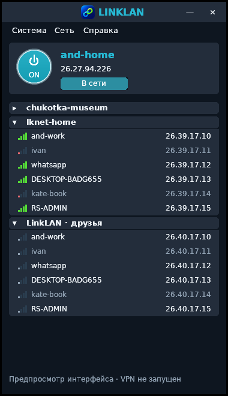

# Интерфейс LinkLAN 0.3.0

Компактный native Win32-клиент с оформлением по предоставленному примеру:
тёмные панели, бирюзовая кнопка питания, карточка своего компьютера, отдельные
колонки имени и IP, сворачиваемые сети, зелёные индикаторы реального ICMP,
подсветка выбора, тёмные меню и окно свойств участника.

Размер по умолчанию 380 × 660 при 100%; окно перетаскивается за верхнюю панель
и изменяет размер за края. Меню содержит создание и присоединение к сети,
смену имени/сервера, настройки темы, брандмауэр и справку. Правый щелчок по
участнику: копировать IP, Ping, свойства; действия владельца доступны только
владельцу. Двойной щелчок по участнику выполняет Ping, по сети — подключение.
F5 обновляет, Ctrl+C копирует IP выбранного участника, Enter подключает сеть
или выполняет Ping, F10 открывает меню. Нажатие на собственный IP копирует его.

Удалённый рабочий стол и передача файлов не реализованы и не представлены
в меню как доступные функции. IPv6 и TCP-канал не имитируются: свойства показывают
фактические данные IPv4 и маршрута P2P/relay.

Новый значок с синим и зелёным звеньями создан для LinkLAN по предоставленному
образцу. Исходник: assets/linklan-icon.png. ICO содержит 16, 20, 24, 32, 48,
64, 128 и 256 px. Он встроен в EXE, окно, установщик и деинсталлятор. Windows
File Properties содержит ProductName и текущую версию. Сборка ресурсов использует
только Python stdlib: scripts/build-resource.py, без новых Go-зависимостей.

## Проверка и сборка

```bash
python3 scripts/build-client.py --installer
```

Команда сама создаёт cmd/client/resource_windows_amd64.syso. При ручной
кросс-компиляции сначала запустите `python3 scripts/build-resource.py`.
NSIS требуется только для `--installer`. Dockerfile.client тоже создаёт ресурсы.

```powershell
.\LinkLAN.exe --ui-preview
```

Автономный предпросмотр показывает демонстрационные данные и не читает и не
изменяет DPAPI-профиль, не требует администратора, не подключается к серверу и
не создаёт VPN/правила брандмауэра. Это инструмент проверки оформления, не
подтверждение действующего соединения. Обычный запуск использует сохранённый
профиль и настоящие данные сервера.

Клиент 0.3.0 совместим с API сервера 0.2.5. Профиль пользователя и ключ устройства
сохраняются. Для установленного API-only шлюза конфигурация TLS на сервере
сохраняется отдельно; обновление клиента не меняет её.


