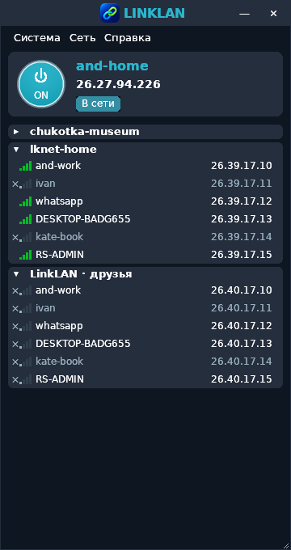

# LinkLAN 0.4.0 — доработка по LinkLAN_TZ_redesign.pdf

Клиент совместим с действующим сервером 0.2.5. Сетевое ядро, ключи устройства,
DPAPI-профиль, правила доступа и схема подключения не заменялись.

## Главное окно и карточки

- Размер по умолчанию 360 × 680, минимальный 320 × 400 логических px.
- Палитра: фон #0E1621, карточки #252E3D, выбор #2B5278, наведение #2F3F4E,
  акцент #29B7CE, белый текст и второстепенный #9AAFC0.
- Компактная панель, имя 16 Semibold, собственный IP 14 Bold, плашка статуса
  по ширине текста. Круглая кнопка имеет градиент, двойной ободок и подсветку.
- Единый фон заголовка сети и участников; промежуток между сетями, скругления
  только внешней карточки. Строки участников 22 px, имя с многоточием,
  IP выровнен справа. У TreeView общий базовый шаг 22 px; высота заголовков
  адаптирована к native-контролу вместо отдельной 28-px строки.
- Выделение и наведение строки, индикаторы реального ICMP: <=50 мс четыре зелёные,
  <=100 три зелёные, <=200 две жёлтые, выше одна красная. Нет подтверждённого
  соединения — серые полосы и крестик. Подсказки поясняют состояние и задержку.
- Нижняя дублирующая панель убрана. Внизу остался только угол изменения размера.
  Ошибка отображается плашкой; нажатие на неё показывает подробности.
- Размер, положение и раскрытие сетей сохраняются в существующем DPAPI-профиле.
  При восстановлении окно ограничивается рабочей областью ближайшего монитора.
  Обновления heartbeat/session без изменений видимых полей не перестраивают дерево.
- Поддерживается WM_DPICHANGED; шрифты, размеры и иконки пересчитываются. Проверяются
  варианты 96/120/144/192 DPI (100/125/150/200%) и 50 сетей / 500 участников.

Контекст участника: копировать IP/имя, пинг, свойства, управление участником
для владельца. RDP запускает системный mstsc.exe, общие папки — системный
explorer.exe с VPN IPv4, только по явному выбору и для активной сети. Пароли
Windows не сохраняются в LinkLAN. Контекст сети: сведения, копирование имени,
сворачивание, подключение, выход и удаление с проверкой прав.

## Трей и автозагрузка

Сворачивание и крестик убирают окно с панели задач в область уведомлений;
VPN продолжает работать. Один щелчок по значку открывает окно, правая кнопка —
меню «Открыть / Подключить или отключить VPN / Настройки / Выход».
Полный выход выполняется через меню «Выход». Если Windows не принимает значок
трея, окно не скрывается без возможности восстановления. После перезапуска
Explorer значок регистрируется повторно.

Повторный запуск ярлыка открывает существующее окно. Именованный mutex не
позволяет создать второй экземпляр GUI. Явный headless-режим остаётся отдельным
режимом командной строки. Профили, окна и задание автозапуска привязаны
к текущему пользователю; межпользовательские задания не создаются.

После первого обычного запуска автозагрузка включается автоматически, согласно
запросу на эту доработку. Её можно отключить в «Система → Сервер и настройки →
Запускать при входе Windows (в трее)». Она отделена от «Подключать последнюю сеть».
Последнюю сеть клиент подключает только при включённой соответствующей настройке.

Используется видимое задание Планировщика `LinkLAN-<SID>`: вход текущего пользователя,
InteractiveToken, HighestAvailable, задержка 10 секунд, команда `--start-hidden`.
Пароль не требуется и не сохраняется. Это не служба и не запуск под SYSTEM.
Первый запуск требует администратора для Wintun и регистрации задания; тихий
последующий запуск рассчитан на учётную запись с правами администратора.
Для обычной неадминистративной учётной записи это не заменяет требование прав Wintun.

Для portable сохраняйте программу в постоянной папке. При перемещении ручной
запуск обновляет путь в собственном задании. Установщик останавливает клиент перед
заменой файлов; удаление программы убирает собственную задачу автозапуска, сохраняя
личный DPAPI-профиль для возможной повторной установки.

```powershell
# Эти команды выполняются из папки клиента; управление задачей требует администратора.
.\LinkLAN.exe --autostart enable
.\LinkLAN.exe --autostart status
.\LinkLAN.exe --autostart disable
.\LinkLAN.exe --quit
```

Для ручного управления автозагрузкой через CLI сначала завершите запущенный клиент.
В повседневной работе используйте настройку в интерфейсе.

## Проверки

- Go-тесты включают границы индикаторов, состояния карточки, схему logon task,
  XML-экранирование путей, DPI-арифметику, сохранность данных устройства при
  сохранении UI-настроек и исключение heartbeat из перестроения дерева.
- Автономные fixture-режимы не читают реальный профиль, не меняют автозапуск,
  не создают VPN или правила брандмауэра.
- Windows CI проверяет установку, ресурсы, задачу автозапуска и её удаление,
  большой список, DPI-варианты, повторный запуск, DPAPI-геометрию и её восстановление.
  Трей проверяется через Shell_NotifyIconGetRect при наличии области уведомлений
  Explorer; отсутствие этой возможности отмечается отдельно в results.json.
- Wine/Xvfb используется для визуальной проверки. Это не заменяет ручные испытания
  настоящего входа в Windows, перемещения между физическими мониторами и VPN/NAT.

```powershell
.\LinkLAN.exe --ui-preview
.\LinkLAN.exe --ui-preview-large --ui-preview-dpi 144
```


