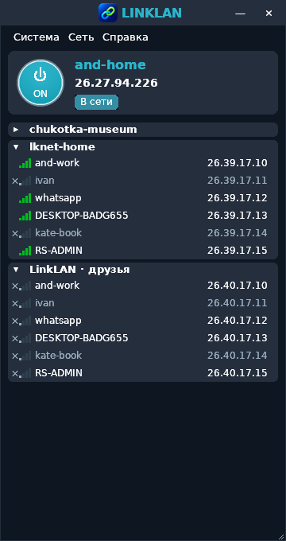
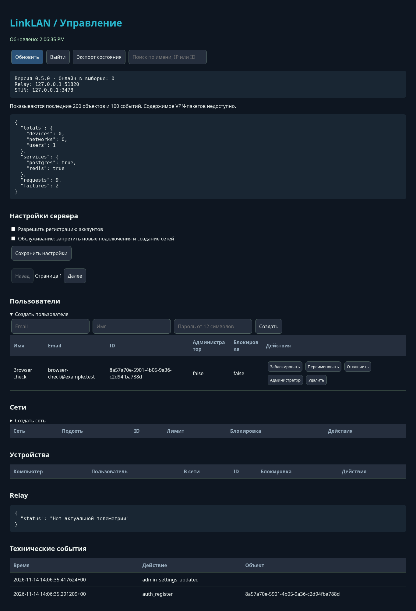

# LinkLAN 0.5.0

Интерфейс уточнён по 86-секундной записи пользователя: компактное окно и карточка компьютера, круглая кнопка с красным выключенным состоянием, список сетей, контекстные меню, свойства и отдельный системный ping (`ping.exe -t -S <VPN IP> <peer IP>`). Боковые разделы настроек: сервер, тема, автозапуск, администрирование. Сохраняются значок LinkLAN, тёмная/светлая темы, DPI, трей, автозагрузка и восстановление окна.

Админ-панель открывается в браузере из меню «Система». Проверяет отдельный серверный токен при каждом запросе. После выхода или перезагрузки страницы нужно ввести токен заново. Данные и пользовательские имена выводятся через textContent.

Проверены локальные API с PostgreSQL/Redis, неправильный/отсутствующий токен, ротация, ограничения обычных клиентов, CRUD, отзыв подключений, участники и обслуживание. Chromium/Playwright проверил вход/выход по `/admin` и `/api/admin`, создание пользователя, поиск и сохранение настроек, без JS-ошибок. Нативный Windows EXE проверен в Wine/Xvfb; установку и системные действия дополнительно проверяет GitHub Windows smoke. Реальное VPN-соединение и вход Windows после перезагрузки требуют физических Windows-машин.

Порядок обновления сервера и границы административных операций: [UPGRADE-0.5.0.md](UPGRADE-0.5.0.md).
