# LinkLAN 0.6.0: светлый редизайн

Доработка существующего Win32-клиента по REDESIGN-SPEC-0.6.0.md. VPN-движок, адресация, API и токеновая админка сохранены. Используется собственный логотип LinkLAN.

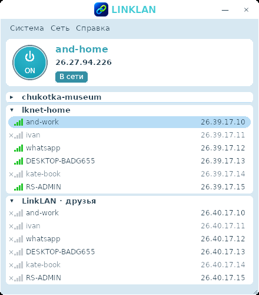

Светлая палитра: фон #D7E8F2, карточки/заголовок #FFFFFF, текст #243F50, выделение #B8DDF6, неактивное выделение #D5D5D5. Тёмная тема распространяется на меню и диалоги; автоматическая читает AppsUseLightTheme и реагирует на WM_SETTINGCHANGE/WM_THEMECHANGED.

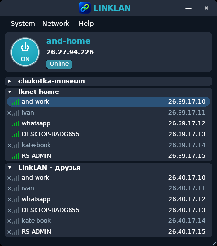

Начальный размер 440×500, минимум 250×350, сохранённые размеры имеют приоритет. Колонка IPv4 резервирует 112 логических пикселей; имена сокращаются многоточием. Заголовок и кнопки остаются в границах окна. Круглая кнопка показывает ON только при запущенном VPN-движке; отключённое состояние серое, ожидание анимировано. Задержка выводится только после реального измерения. Крестик у участника означает сообщённое сервером отключение; неизмеренное/недоступное ICMP отображается нейтральными столбиками.

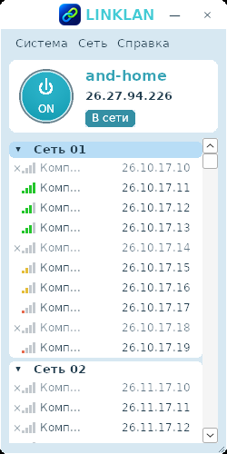

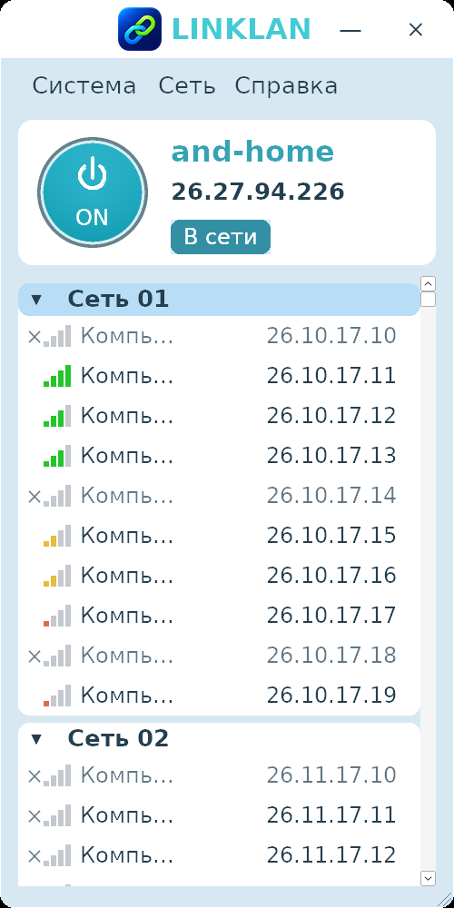

Настройки 435×380: белая боковая панель с векторными GDI-иконками, шесть разделов, радиокнопки и переключатели. Интерфейс поддерживает русский и English без изменения пользовательских имён/сетей. Тексты ответа сервера и системных программ сохраняют смысл исходного сообщения.

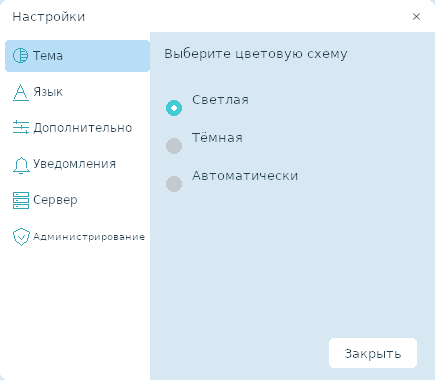
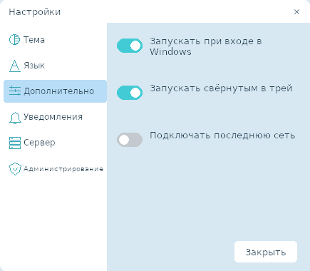
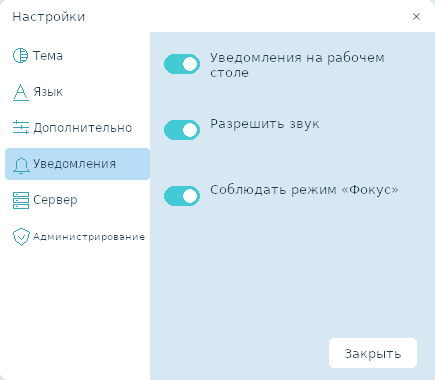
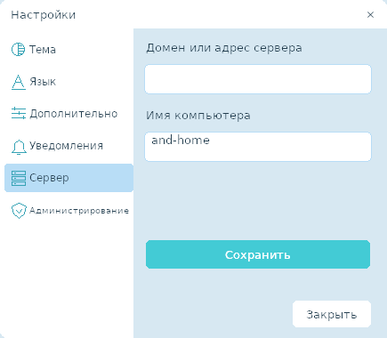
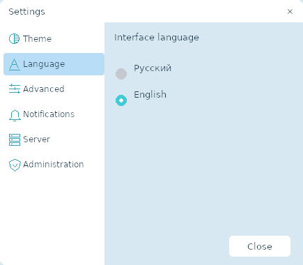

Диалоги получили общий заголовок, голубой фон, белые поля, бирюзовую основную кнопку и закрытие по Escape. Создание сети по приглашению сохранено. Enter в настройках сервера сохраняет сервер; в остальных разделах завершает работу с настройками, не выполняя подключение.

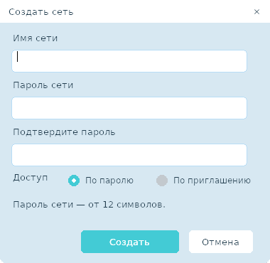
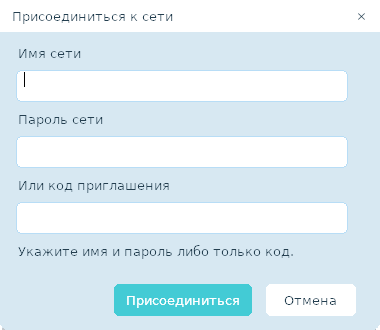
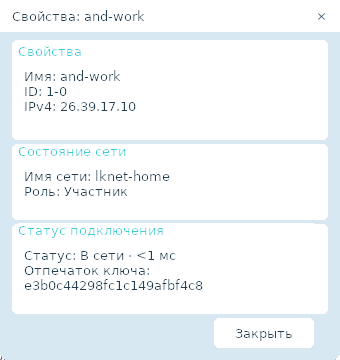

Статусы и IP обновляются в существующих строках TreeView; полная перестройка нужна при изменении состава/порядка участников. Выбор, прокрутка и раскрытие сохраняются. Короткие переподключения не порождают повторные уведомления.

Проверено локально: 56 успешных Go-проверок с PostgreSQL, включая кириллицу в XML автозагрузки, сохранность ключей профиля, перевод всех статических подписей и подавление уведомлений при коротком переподключении; четыре Python-проверки ресурсов/упаковки и vet. Windows EXE прошёл в Wine 16 сочетаний ширины 250/300/440/600 и DPI 96/120/144/192, измерение полного IPv4 тем же шрифтом в своём процессе, границы кнопок, все разделы настроек, язык и смену системной темы. Численные результаты: screenshots/0.6.0/layout-checks.jsonl. На снимках используются автономные тестовые данные `--ui-preview`, а не подменённое состояние рабочего VPN.

GitHub Windows smoke дополнительно проверяет установку, ресурсы, реальное задание автозагрузки, эти 16 компоновок, переключение языка, сохранение новых параметров в DPAPI, запуск видимого окна по предпочтению, единственный экземпляр и восстановление размеров. Конкретный результат смотрите в Actions соответствующего релиза. Утверждения о трее в Windows-тесте условны при отсутствии Explorer. Реальное VPN и физические мониторы требуют проверки на Windows-машинах пользователя.
